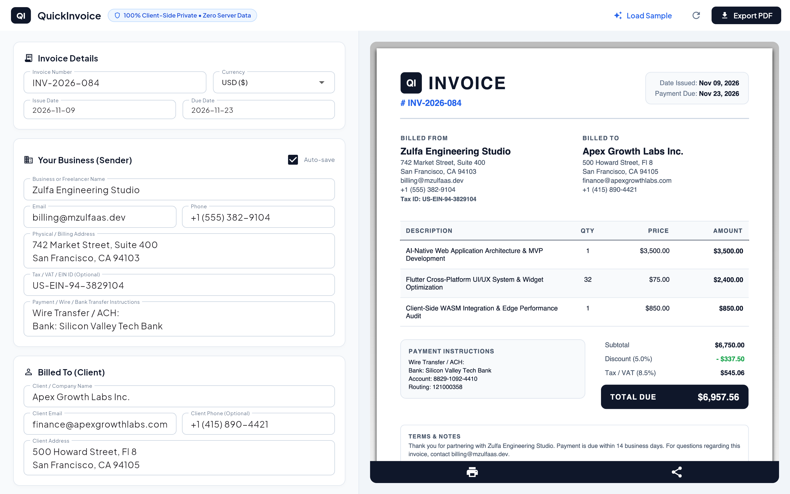

# QuickInvoice ⚡🧾

> **100% Private, Client-Side Invoice Maker built with Flutter (Web & Mobile).**  
> Create, customize, and export professional PDF invoices in seconds. No login. No server database. Zero data leaks.

[](https://flutter.dev)
[](https://opensource.org/licenses/MIT)
[](#privacy-guarantee)
[](https://mzulfaas.github.io/quick-invoice/)

---



## 🚀 Live Demo

Try the live Flutter Web application right in your browser:  
🔗 **[https://mzulfaas.github.io/quick-invoice/](https://mzulfaas.github.io/quick-invoice/)**

---

## ✨ Features

- **🔒 100% Client-Side Privacy**: All data processing and PDF compilation happens directly in your browser or device memory. No data is ever sent to a remote backend.
- **⚡ Instant PDF Generation**: Vector-grade, high-DPI PDF generation powered by `pdf` and `printing` engine.
- **📱 Responsive Cross-Platform**:
  - **Desktop / Web**: Side-by-side interactive split editor and live PDF preview.
  - **Mobile (Android / iOS)**: Adaptive tabbed interface optimized for single-handed workflow.
- **🌍 Multi-Currency Support**: Instant formatting for USD (`$`), EUR (`€`), GBP (`£`), IDR (`Rp`), SGD (`S$`), and AUD (`A$`).
- **💾 Local Persistence**: Remembers your business details and last invoice automatically via local browser/device storage (`SharedPreferences`).
- **🎯 1-Click Sample**: Recruiter and tester friendly — pre-populates realistic data in one click for instant review.
- **📐 Flexible Calculations**: Dynamic line-item quantity/price, automatic subtotal, configurable tax/VAT rate, and discount percentages.

---

## 🛠️ Architecture & Tech Stack

```
quick-invoice/
├── lib/
│   ├── models/
│   │   └── invoice.dart          # Data structures, calculations & currency formatting
│   ├── services/
│   │   ├── pdf_invoice_service.dart # Vector PDF document generator
│   │   └── storage_service.dart     # Offline local storage manager
│   ├── screens/
│   │   └── invoice_screen.dart   # Responsive editor & live preview UI
│   └── main.dart                 # App bootstrap & theme configuration
├── web/                          # Web manifest & SEO OpenGraph tags
└── test/                         # Unit & widget smoke tests
```

- **Framework**: [Flutter](https://flutter.dev/) (Channel Stable, Dart 3.9+)
- **PDF Engine**: `pdf` & `printing`
- **Typography**: Google Fonts (Plus Jakarta Sans)
- **Local Cache**: `shared_preferences`
- **Formatting**: `intl`

---

## 🔒 Privacy Guarantee

Most online invoice tools upload your confidential customer names, hourly rates, and bank account numbers to third-party cloud servers. **QuickInvoice does not.**

1. **Zero Remote Requests**: Inspect your browser's Network tab — no invoice data leaves your machine.
2. **Zero Analytics / Tracking**: No Google Analytics, no Facebook Pixels, no telemetry scripts.
3. **Offline Ready**: Works completely offline once loaded.

---

## 🏃 Getting Started

### Prerequisites

- Flutter SDK (>= 3.24.0)
- Dart SDK (>= 3.5.0)

### Run Locally

```bash
# Clone the repository
git clone https://github.com/mzulfaas/quick-invoice.git
cd quick-invoice

# Install dependencies
flutter pub get

# Run on Chrome (Web)
flutter run -d chrome

# Or run on connected Android/iOS device
flutter run
```

### Build for Production

```bash
# Web
flutter build web --release

# Android APK / App Bundle
flutter build apk --release
flutter build appbundle --release
```

---

## 📄 License

This project is open-source under the [MIT License](LICENSE).

Developed with precision by [Muhamad Zulfa](https://github.com/mzulfaas).
