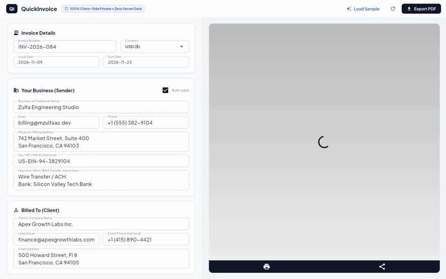

# QuickInvoice ⚡🧾

> **100% Private, Client-Side Invoice Maker built with Flutter (Web, Desktop, and Mobile).**  
> Create, calculate, customize, and export vector-grade PDF invoices in seconds. No account required, no cloud database, and zero data leakage.

[](https://flutter.dev)
[](https://mzulfaas.github.io/quick-invoice/)
[](#privacy-guarantee)
[](LICENSE)

---

## 🎬 Live Demo & Video Showcase



> 📹 **High-Definition Video**: [quickinvoice_demo_showcase.mp4](quickinvoice_demo_showcase.mp4) (Watch raw walkthrough in GitHub video player)  
> 🔗 **Interactive Web App**: [https://mzulfaas.github.io/quick-invoice/](https://mzulfaas.github.io/quick-invoice/)

---

## 💡 The Problem with Online Invoicing Software

Most commercial invoice platforms require users to sign up, log in, and store their client lists, billing addresses, hourly rates, and banking credentials in remote cloud databases. 

For freelancers, consultants, and independent agencies, this introduces unnecessary friction, monthly recurring subscription fees, and severe privacy exposure.

**QuickInvoice eliminates the backend entirely.** By running Flutter compiled to WebAssembly/JavaScript, all financial calculations, layout reflows, and vector PDF compilation happen locally in your device's memory.

---

## ✨ Key Capabilities

* **🔒 100% Client-Side Privacy**: All calculations and document assembly run strictly in device memory. No data is ever transmitted to a remote server.
* **⚡ Vector-Grade PDF Generation**: Unlike tools that take low-resolution canvas snapshots, QuickInvoice renders true vector elements (crisp at any zoom level, printable at 300+ DPI).
* **📱 Adaptive Responsive Layout**:
  * **Desktop and Tablet**: Split-screen live preview that dynamically re-renders the document as you type.
  * **Mobile (Android and iOS)**: Collapsible single-column editor optimized for quick single-handed thumb input.
* **🌍 International Currency Formatting**: Native currency symbols and decimal standards for USD (`$`), EUR (`€`), GBP (`£`), IDR (`Rp`), SGD (`S$`), and AUD (`A$`).
* **💾 Local Offline Persistence**: Automatically caches your business details and default terms in browser/device storage via `SharedPreferences`.
* **🎯 1-Click Sample Pre-population**: Allows recruiters, clients, and testers to preview full-fidelity invoices with a single tap.
* **📐 Flexible Calculation Engine**: Dynamic line-item additions, configurable tax/VAT rates, and custom discounts computed in real time.

---

## 🛠️ System Architecture & Data Flow

```
[ User Input / Form State ]
            │
            ▼
[ Invoice Model & Calc Engine ]
  • Reactive tax, discount, and subtotal recalculation
  • Formats currency through intl number formatters
            │
            ▼
[ PDF Service: pdf / printing ]
  • Constructs vector document tree (Header, Line Items, Summary, Notes)
  • Compiles binary PDF into RAM buffer (~150ms)
            │
            ▼
┌───────────────────────────┴───────────────────────────┐
│                                                       │
▼                                                       ▼
[ Desktop: Live Split Preview ]             [ Instant PDF Export ]
  • Renders live rasterized preview           • Direct browser download
  • Updates dynamically on keystroke          • 0 network roundtrips
```

### Folder Architecture

```
quick-invoice/
├── lib/
│   ├── models/
│   │   └── invoice.dart          # Data models, financial math, currency parser
│   ├── services/
│   │   ├── pdf_invoice_service.dart # Vector PDF document generator
│   │   └── storage_service.dart     # Offline local storage manager
│   ├── screens/
│   │   └── invoice_screen.dart   # Responsive editor and live preview UI
│   └── main.dart                 # Application entrypoint and theme setup
├── web/                          # Web manifest and PWA configuration
└── test/                         # Unit tests and widget smoke checks
```

---

## ⚡ Performance & Comparison

| Metric | Traditional Cloud Invoicer | QuickInvoice (Client-Side) |
| :--- | :---: | :---: |
| **Data Transmission** | Client names & rates stored remotely | **0 bytes leaves machine** |
| **Generation Latency** | 1,200ms - 3,500ms (API roundtrip) | **~150ms (In-RAM Compilation)** |
| **Offline Support** | ❌ Fails without active internet | **✅ 100% Functional Offline** |
| **Monthly Subscription** | $15 - $30 / month | **Free and Open-Source (MIT)** |
| **Compliance Risk** | Third-party cloud data exposure | **GDPR & HIPAA compliant by architecture** |

---

## 🔒 Privacy Guarantee

1. **Zero Network Requests**: Check your browser Network tab during generation: no API calls or analytics beacons are dispatched.
2. **Zero Telemetry**: No trackers, tracking cookies, or tracking pixels.
3. **Local Storage Only**: Data saved between sessions stays in your browser's private local storage partition.

---

## 🏃 Getting Started Locally

### Prerequisites

* Flutter SDK (>= 3.24.0)
* Dart SDK (>= 3.5.0)

### Installation & Run

```bash
# 1. Clone the repository
git clone https://github.com/mzulfaas/quick-invoice.git
cd quick-invoice

# 2. Install dependencies
flutter pub get

# 3. Launch in Chrome (Web)
flutter run -d chrome

# 4. Or launch on connected mobile device / emulator
flutter run
```

### Production Release Build

```bash
# Compile optimized Web release
flutter build web --release

# Compile Android APK / App Bundle
flutter build apk --release
flutter build appbundle --release
```

---

## 📄 License

This project is open-source under the [MIT License](LICENSE).

Developed with engineering focus by [Muhamad Zulfa](https://github.com/mzulfaas). Feedback and pull requests are welcome.
